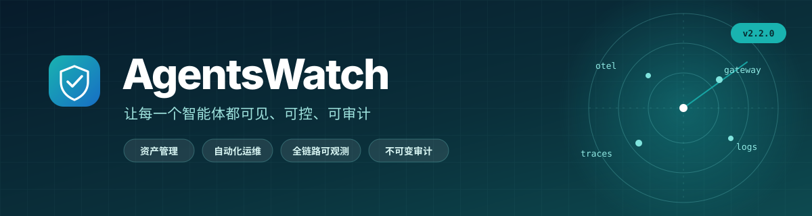
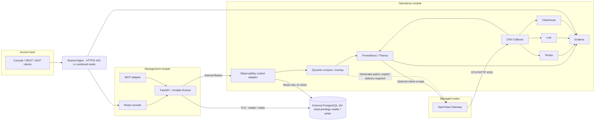

<div align="center">

**English** · [简体中文](README.zh-CN.md)



<br>

[](CHANGELOG.md)
[](https://www.python.org/)
[](frontend/package.json)
[](docker-compose.yml)
[](LICENSE)
[](#-quality-and-verification)

**An integrated asset management, automation, and full-stack observability platform for OpenClaw and multi-runtime agents.**

Bring agents scattered across dozens of servers into one queryable asset graph.
Put risky bulk operations behind controlled, reversible, auditable automation.
Reconstruct every call from the three OTel signals.

[Quick start](#-quick-start) · [Capabilities](#-core-capabilities) · [Architecture](#-architecture) · [Deployment](#-deployment-modes) · [Docs](#-documentation)

</div>

---

## Why AgentsWatch

Once an agent grows from a demo into dozens of business roles running on production servers, operations tend to fall back to spreadsheets, SSH, and verbal handovers. AgentsWatch closes those three gaps:

| Common pain | How AgentsWatch solves it |
| --- | --- |
| Agents are spread across servers and runtimes; ownership lives in someone's head | A three-level **Server → Runtime → Primary/Subagent** model fixes ownership, with departments, people, and management groups as cross-cutting views |
| Configuration changes rely on manual SSH; failures are hard to locate or roll back | Operations become **controlled playbooks**: preflight → explicit confirmation → per-target execution → structured results → failure compensation |
| When something breaks, you cannot tell whether the gateway, runtime, or model call failed | Full **metrics / traces / logs** ingestion, cross-checked against OpenClaw's native Prometheus endpoint |
| Permissions and audit are verbal agreements | `admin / operator / viewer` RBAC, API keys, one-time confirmations, and an immutable operation event stream |

---

## ✨ Core capabilities

### 🗂 Management: one graph for every agent

- **Three-level asset model**: Server → Runtime → Agent (primary / subagent), with traceable, filterable, batch-operable relationships.
- **Organization and people**: department trees, people, employee numbers, business admins / IT admins / accessible users — agents belong to real business roles.
- **Management groups**: static virtual groups of servers, runtimes, and agents, reusable as batch-operation target sets.
- **Excel bulk import**: template export, validation preview, diff review, and transactional import for five master-data types. Empty cells, explicit clears, and conflicts all have defined semantics.
- **First-time onboarding and runtime lifecycle**: password bootstrap → install platform public key → verify key-only login → onboarding complete. Supports systemd / systemd-user / launchd runtime drivers.
- **Agent deployment sync**: synchronize primary/subagents, independent Feishu accounts, and routes onto a shared runtime, with first deployment, same-runtime sync, controlled migration, and removal.
- **Automation library and task center**: versioned playbooks, parameter-schema validation, batch execution, per-target results, failed-target retry, and queue cancellation.
- **Permissions, API keys, and audit**: three-level RBAC, one long-lived API key per user (rotatable/revocable), one-time confirmation for writes, and an immutable operation event stream.

### 🔭 Operations: from telemetry ingest to reversible configuration

- **OpenClaw's official `diagnostics-otel`**: metrics, traces, and logs over OTLP/HTTP.
- **Storage tiers**: Prometheus for live metrics, Thanos for long-term storage, Tempo for traces, Loki for logs, ClickHouse for analytical copies, MinIO for objects.
- **Dual-channel verification**: scrape the native Prometheus endpoint and the OTel pipeline in parallel, so metric drift, ingestion gaps, and endpoint failures become visible instead of silent.
- **Versioned inventory**: manifest/overlay driven by local JSON or the management database v2 views, producing atomic revisions with explicit delivery and rollback.
- **Ready-to-use Grafana**: cluster overview, gateway detail, and operations report dashboards with fixed query semantics — no manual copy-paste.
- **Alerting**: Alertmanager rules are decoupled from notification receivers; the default computes alerts, production wires in an organization's receiver.

### 🧩 Three delivery shapes, composed as needed

| Shape | Best for | Entry point |
| --- | --- | --- |
| **Management + operations** | You need assets, automation, and observability together | Shared Nginx `443` |
| **Management only** | Assets, import, tasks, API / MCP | Management Nginx `8443` |
| **Operations only** | You already have an inventory and only need telemetry + Grafana | Operations Nginx `443` |

Management and operations backends live on separate networks. In the combined deployment, a shared Nginx joins both networks and becomes the only cross-network proxy. Each side can be deployed, upgraded, and rolled back independently.

---

## 🌟 Project highlights

<table>
<tr>
<td width="50%" valign="top"><strong>🛡 Fail-closed security defaults</strong><p>Production Compose refuses to start when an image, password, DSN, or Fernet key is missing (<code>${VAR:?}</code>). Images run with <code>pull_policy: never</code>; the management container is <code>read_only</code> with <code>cap_drop: ALL</code> and <code>no-new-privileges</code>; database connections require <code>sslmode=verify-full</code>.</p></td>
<td width="50%" valign="top"><strong>↩️ Reversible automation</strong><p>Every inventory change becomes an immutable revision and only touches runtimes when you explicitly deliver it. Agent deploy / migrate / remove flows include failure compensation that unwinds completed remote steps in order.</p></td>
</tr>
<tr>
<td width="50%" valign="top"><strong>🔍 Dual-channel telemetry</strong><p>OTel and the native OpenClaw Prometheus endpoint are scraped in parallel. The same metric from two sources makes drift, ingestion outages, and endpoint anomalies explicit rather than silently lost.</p></td>
<td width="50%" valign="top"><strong>🧾 Immutable audit</strong><p>Logins, asset changes, permission updates, task execution, and one-time confirmations all land in the operation event stream. AppSecrets, passwords, and tokens never appear in lists, details, or audit output — only a "configured" boolean.</p></td>
</tr>
<tr>
<td width="50%" valign="top"><strong>🧱 Single-worker safety boundary</strong><p>Task recovery and execution deliberately stay inside one worker process to avoid duplicate execution and recovery races. Scaling out is a documented decomposition, not a silent concurrency bump.</p></td>
<td width="50%" valign="top"><strong>🧩 Modular and decoupled</strong><p>The management API, Ansible runner, MCP adapter, and observability control plane are independent. MCP reaches the API only over REST, enforced by an AST test that forbids database, shell, or Ansible imports.</p></td>
</tr>
</table>

---

## 🏗 Architecture



### Ports and network boundaries

| Port | Purpose | Default bind |
| --- | --- | --- |
| `443` | Only user-facing HTTPS entry in combined mode (Grafana + console + MCP) | `0.0.0.0` |
| `4318` | OpenClaw OTLP/HTTP data plane | `0.0.0.0` (protect with ACLs) |
| `8443` | Standalone management HTTPS entry | `0.0.0.0` |
| `3000` / `9090` / `9093` / `10902` | Grafana / Prometheus / Alertmanager / Thanos Query | `127.0.0.1` |
| `8123` / `9001` | ClickHouse HTTP / MinIO Console | `127.0.0.1` |
| Management API / MCP | Container-internal Unix domain sockets only | No TCP |

See the [system architecture document](docs/system-architecture.md) for the full design.

---

## 🚀 Quick start

### Prerequisites

- Python **3.12+**
- Node.js **22+**
- Docker Engine with the Docker Compose plugin

### One-command local stack

```bash
# 1. Create an untracked local inventory
cp cluster/lobsters.example.json cluster/lobsters.json

# 2. Start isolated PostgreSQL, management API, MCP, observability adapter, and frontend
./scripts/local_management_stack.sh start

# 3. Show the actual ports, login user, and password file path
./scripts/local_management_stack.sh status
```

Services prefer frontend `4173`, API `8000`, MCP `8010`, and adapter `8011`; the script picks free ports when there is a conflict. The database and services bind to `127.0.0.1` only.

Stop the stack:

```bash
./scripts/local_management_stack.sh stop
```

### Frontend-only development

```bash
cd frontend
npm install
npm test
npm run dev -- --host 127.0.0.1 --port 4173 --strictPort
```

> The default development account is for loopback-only local use and **must never be used in production**. `.env`, `cluster/lobsters.json`, `.local-data/`, certificates, tokens, passwords, and any credentials must not be committed.

---

## 📦 Deployment modes

| Mode | Use case | Inventory source | Entry |
| --- | --- | --- | --- |
| Management + operations | Assets, automation, and observability all needed | Management PostgreSQL v2 views | Shared Nginx `443` |
| Management only | Assets, groups, import, tasks, API / MCP | Management PostgreSQL v2 views | Management Nginx `8443` |
| Operations only | Existing inventory; telemetry and Grafana only | `cluster/lobsters.json` | Operations Nginx `443` |

Combined mode must use the repository's `deploy/combined` overlays; do not hand-assemble two independent ingresses. Configuration, startup order, acceptance, and rollback for all three modes are documented in the [deployment guide](docs/deployment-guide.md).

---

## 🔐 Security model

- **Authentication**: scrypt password hashing, login lockout, 8-hour sessions, CSRF double-submit + SameSite.
- **Authorization**: `admin` / `operator` / `viewer` permission matrix enforced per route on the server; the UI only provides hints.
- **API keys**: one long-lived key per user, stored as SHA-256 plus a display prefix, with rotation and immediate revocation.
- **Destructive operations**: one-time confirmation bound to method / path / query / body and consumed on use.
- **Credential encryption**: Runtime WebUI and SSH credentials use separate Fernet keys; AppSecrets are never returned.
- **Transport and boundaries**: management API/MCP over UDS only; database TLS `verify-full`; OTLP `4318` must be protected by a trusted network and ACLs.
- **Containers**: read-only root filesystem, `cap_drop: ALL`, `no-new-privileges`, `pids_limit`, tmpfs.
- **Audit**: immutable operation events; sensitive fields are recorded only as `credential_configured`.

Report vulnerabilities through a GitHub Private Security Advisory; see [SECURITY.md](SECURITY.md).

---

## 🧭 Repository layout

```text
agentswatch/
├── agentswatch_api/            # FastAPI management API: assets, org, auth, tasks
├── agentswatch_automation/     # Ansible runner wrapper, path checks, output redaction
├── agentswatch_mcp/            # Stateless MCP adapter (REST-only access to the API)
├── agentswatch_observability/  # Observability control plane: revision, overlay, rollback
├── automation/                 # Built-in playbooks / roles / automation catalog
├── frontend/                   # React 19 + Vite console
├── database/core-assets/       # Ordered PostgreSQL migrations (authoritative)
├── deploy/                     # management / combined / postgres / offline
├── cluster/                    # Local JSON inventory for operations-only mode
├── prometheus/ tempo/ loki/    # Telemetry backend configuration
├── grafana/                    # Data sources and dashboards
├── docs/                       # Architecture, deployment, data dictionary, validation
├── scripts/                    # Local stack, migrations, release hygiene
└── tests/                      # Python unit / integration / SQL / fixtures
```

---

## ✅ Quality and verification

| Check | Command | Current result |
| --- | --- | --- |
| Python tests | `python3 -m unittest discover -s tests -v` | **386 tests**, 0 failed (46 integration/environment-dependent skipped) |
| Frontend tests | `npm --prefix frontend test` | **68 tests**, all passing |
| Frontend build | `npm --prefix frontend run build` | Success |
| Compose syntax | `docker compose config --quiet` | Pass |
| Release hygiene | `python3 scripts/check_public_release.py --history` | Pass |

CI covers release hygiene, Ruff static checks, Compose syntax, Python tests, frontend tests, and the production frontend build. Some integration tests need local Docker / PostgreSQL; read the header of the corresponding script before running them.

---

## 📚 Documentation

> The `docs/` tree is currently maintained in Chinese. English translations are welcome.

| Document | Content |
| --- | --- |
| [Documentation index](docs/README.md) | Full index by architecture, integration, deployment, and development |
| [System architecture](docs/system-architecture.md) | Components, control flow, telemetry flow, security boundaries, degradation |
| [Deployment guide](docs/deployment-guide.md) | Full steps and rollback for the three deployment modes |
| [Core asset architecture](docs/core-data-architecture.md) | Server / Runtime / Agent / Deployment model |
| [Data dictionary](docs/core-data-dictionary.md) | Tables, fields, enums, sensitivity levels |
| [Bulk import contract](docs/asset-import-contract.md) | Excel validation, preview, diff, and transactional commit |
| [Automation execution](docs/automation-task-execution.md) | Playbooks, preflight, events, and per-target results |
| [Open API](docs/open-api-access.md) / [MCP](docs/mcp-service.md) | API keys, permissions, MCP boundaries |
| [Telemetry persistence](docs/data-persistence.md) / [Grafana](docs/grafana-dashboards.md) | Retention and query semantics |
| [Local stack](docs/local-management-stack.md) | PostgreSQL, API, MCP, and frontend on a workstation |

---

## ⚠️ Production constraints

- Management task recovery and execution still run **inside a single worker process** and cannot be scaled to multiple workers directly.
- The observability data stack is a **single-host Compose** deployment, not HA.
- Operations-only mode needs a separate supervisor and secure entry point if the adapter API stays exposed long-term.
- OTLP `4318` currently has no TLS or application-layer authentication; protect it with a trusted network and ACLs.
- Alertmanager only computes alerts by default; production must configure an organization receiver.
- Default image examples include `latest`; production must pin versions or digests.
- The production frontend build still emits a chunk-size warning; split it per page in a later release.

---

## 🤝 Contributing and license

Issues and pull requests are welcome. Read [CONTRIBUTING.md](CONTRIBUTING.md) first:

```bash
python3 -m unittest discover -s tests -v
npm --prefix frontend test
npm --prefix frontend run build
python3 scripts/check_public_release.py --history
```

Licensed under the [Apache License 2.0](LICENSE).

<div align="center">
<br>
<sub>Built for operators who need to trust what their agents are doing.</sub>
</div>
