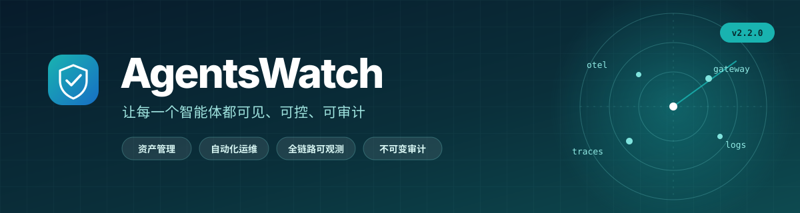
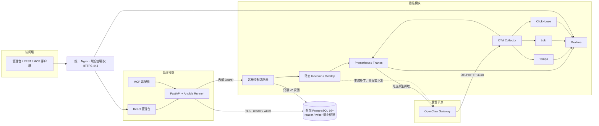

<div align="center">

**简体中文** · [English](README.md)



<br>

[](CHANGELOG.md)
[](https://www.python.org/)
[](frontend/package.json)
[](docker-compose.yml)
[](LICENSE)
[](#-质量与验证)

**面向 OpenClaw 及多运行时智能体的「资产管理 + 自动化运维 + 全链路可观测」一体化平台。**

把散落在几十台服务器上的智能体收拢成一张可查询的资产图谱，
把危险的批量操作收进受控、可回滚、可审计的自动化链路，
再用 OTel 三信号还原每一次调用的真实路径。

[快速开始](#-快速开始) · [核心能力](#-核心能力) · [架构](#-架构) · [部署模式](#-部署模式) · [文档](#-文档导航)

</div>

---

## 为什么需要 AgentsWatch

智能体一旦从「一个 Demo」变成「几十个跑在生产服务器上的业务角色」，管理方式往往会退化成 Excel、SSH 和口头交接。AgentsWatch 针对的正是这三个断层：

| 常见困境 | AgentsWatch 的做法 |
| --- | --- |
| 智能体散落在多台服务器、多个运行时，资产关系靠人记 | 用 **服务器 → 运行时 → 主/子智能体** 三级模型固化归属，再用部门、人员、管理分组做交叉视图 |
| 改配置靠手工 SSH，出问题无法定位、无法回滚 | 把操作收敛为**受控 Playbook**：预检 → 二次确认 → 逐目标执行 → 结构化结果 → 失败补偿 |
| 出故障时不知道是网关、运行时还是模型调用断了 | OTel **metrics / traces / logs** 全量接入，并与 OpenClaw 原生 Prometheus 端点**双通道交叉校验** |
| 权限与审计靠口头约定 | `admin / operator / viewer` 三级权限、API Key、一次性确认、不可变操作事件 |

---

## ✨ 核心能力

### 🗂 管理模块：一张图看清所有智能体

- **三级资产模型**：Server（服务器）→ Runtime（运行时）→ Agent（主智能体 / 子智能体），关系可追溯、可筛选、可批量操作。
- **组织与人员**：部门树、人员、工号、业务管理员 / IT 管理员 / 可访问用户，智能体归属到真实业务角色。
- **管理分组**：面向服务器、运行时、智能体的静态虚拟分组，作为批量任务的可复用目标集合。
- **Excel 批量导入**：五类主数据（部门、人员、云厂商、服务器、分组）的模板导出、校验预览、差异对比、事务入库；空值、清空、冲突都有明确语义。
- **首次纳管与运行时生命周期**：密码首连 → 安装平台公钥 → 仅公钥复验 → 纳管完成；支持 systemd / systemd-user / launchd 多种运行时驱动。
- **智能体部署同步**：把主/子智能体、独立飞书账户与路由同步到共享运行时，支持首次部署、同运行时同步、受控迁移、解除部署。
- **自动化库与任务中心**：Playbook 版本化发布、参数 Schema 校验、批量执行、逐目标结果、失败目标重试、队列取消。
- **权限、API Key 与审计**：三级 RBAC、每用户长期 API Key（可轮换/撤销）、写操作一次性二次确认、不可变操作事件流。

### 🔭 运维模块：从遥测接入到可回滚的配置

- **OpenClaw 官方 `diagnostics-otel` 接入**：metrics、traces、logs 三信号统一走 OTLP/HTTP。
- **存储分层**：Prometheus 实时指标、Thanos 长期存储、Tempo 链路、Loki 日志、ClickHouse 分析副本、MinIO 对象存储。
- **双通道校验**：官方原生 Prometheus 端点与 OTel 主链路并行抓取，指标口径不一致时可直接对比。
- **版本化清单**：本地 JSON 或管理数据库 v2 视图驱动的 manifest / overlay，生成原子 revision，支持显式下发与回滚。
- **开箱即用的 Grafana**：集群总览、实例详情、运营报表三层看板，查询口径固定、不依赖手工抄数。
- **告警计算**：Alertmanager 规则与通知接收器解耦，默认只计算、生产按组织接入通知。

### 🧩 三种交付形态，按需组合

| 形态 | 适合场景 | 入口 |
| --- | --- | --- |
| **管理 + 运维** | 资产、自动化、可观测性全部需要 | 统一 Nginx `443` |
| **仅管理** | 只做资产、导入、任务、API / MCP | 管理 Nginx `8443` |
| **仅运维** | 已有独立清单，只建设遥测与 Grafana | 运维 Nginx `443` |

管理与运维后端位于不同网络；联合部署时共享 Nginx 同时加入两侧网络，成为唯一跨网代理。任一侧都可独立部署、独立升级。

---

## 🌟 项目特色

<table>
<tr>
<td width="50%" valign="top"><strong>🛡 失败关闭的安全默认值</strong><p>生产 Compose 对缺失的镜像、密码、DSN、Fernet key 一律 <code>${VAR:?}</code> 直接拒绝启动；镜像全部 <code>pull_policy: never</code>；管理容器 <code>read_only</code> + <code>cap_drop: ALL</code> + <code>no-new-privileges</code>；数据库强制 <code>sslmode=verify-full</code>。</p></td>
<td width="50%" valign="top"><strong>↩️ 可回滚的自动化</strong><p>每次清单变更都生成不可变 revision，只在你显式下发时才触碰运行时；智能体部署/迁移/解除内置失败补偿，已完成的远端步骤会按顺序回退。</p></td>
</tr>
<tr>
<td width="50%" valign="top"><strong>🔍 双通道遥测校验</strong><p>OTel 主链路与 OpenClaw 原生 Prometheus 端点并行采集。同一指标两套来源，口径漂移、采集中断、端点异常都能被显式发现，而不是静默丢失。</p></td>
<td width="50%" valign="top"><strong>🧾 不可变审计</strong><p>登录、资产变更、权限调整、任务执行、二次确认都写入操作事件流；AppSecret、密码、Token 永不进入列表、详情或审计输出，只记录「已配置」布尔值。</p></td>
</tr>
<tr>
<td width="50%" valign="top"><strong>🧱 单 worker 的安全边界</strong><p>管理 API 的任务恢复与执行刻意保持单 worker 进程内，避免多 worker 下的任务重复执行与恢复竞态；需要扩展时按文档拆分，而不是默默加大并发。</p></td>
<td width="50%" valign="top"><strong>🧩 模块化、低耦合</strong><p>管理 API、Ansible Runner、MCP 适配器、运维控制面各自独立；MCP 只通过 REST 访问管理 API，并用 AST 测试禁止它直接导入数据库、Shell 或 Ansible。</p></td>
</tr>
</table>

---

## 🏗 架构



### 端口与网络边界

| 端口 | 用途 | 默认绑定 |
| --- | --- | --- |
| `443` | 联合部署唯一用户 HTTPS 入口（Grafana + 管理台 + MCP） | `0.0.0.0` |
| `4318` | OpenClaw OTLP/HTTP 数据面 | `0.0.0.0`（需 ACL 保护） |
| `8443` | 仅管理模式的独立 HTTPS 入口 | `0.0.0.0` |
| `3000` / `9090` / `9093` / `10902` | Grafana / Prometheus / Alertmanager / Thanos Query | `127.0.0.1` |
| `8123` / `9001` | ClickHouse HTTP / MinIO Console | `127.0.0.1` |
| 管理 API / MCP | 仅容器内 Unix Domain Socket | 不发布 TCP |

完整设计见[系统架构文档](docs/system-architecture.md)。

---

## 🚀 快速开始

### 前置条件

- Python **3.12+**
- Node.js **22+**
- Docker Engine + Docker Compose 插件

### 本机一键联调

```bash
# 1. 创建不提交的本地清单
cp cluster/lobsters.example.json cluster/lobsters.json

# 2. 启动隔离 PostgreSQL、管理 API、MCP、运维适配器与前端
./scripts/local_management_stack.sh start

# 3. 查看实际端口、登录用户与密码文件路径
./scripts/local_management_stack.sh status
```

服务优先使用前端 `4173`、API `8000`、MCP `8010`、适配器 `8011`；端口冲突时脚本会自动选择空闲端口。数据库与服务均只绑定 `127.0.0.1`。

停止：

```bash
./scripts/local_management_stack.sh stop
```

### 只开发前端

```bash
cd frontend
npm install
npm test
npm run dev -- --host 127.0.0.1 --port 4173 --strictPort
```

> 默认开发账号仅适用于本机回环环境，**不能用于生产**。`.env`、`cluster/lobsters.json`、`.local-data/`、证书、Token、密码和任何凭据都不得提交。

---

## 📦 部署模式

| 方式 | 适用场景 | 清单来源 | 入口 |
| --- | --- | --- | --- |
| 管理 + 运维 | 资产、自动化、可观测性全部需要 | 管理 PostgreSQL v2 视图 | 共享 Nginx `443` |
| 仅管理 | 只做资产、分组、导入、任务、API / MCP | 管理 PostgreSQL v2 视图 | 管理 Nginx `8443` |
| 仅运维 | 已有独立清单，只建设遥测与 Grafana | `cluster/lobsters.json` | 运维 Nginx `443` |

联合模式必须使用仓库提供的 `deploy/combined` 覆盖统一编排，不要手工拼接两套独立入口。三种方式的配置、启动顺序、验收与回滚统一见[部署指引](docs/deployment-guide.md)。

---

## 🔐 安全模型

- **认证**：scrypt 密码哈希、登录失败锁定、8 小时会话、CSRF double-submit + SameSite。
- **授权**：`admin` / `operator` / `viewer` 三级权限矩阵，服务端逐路由校验，前端只做提示不做兜底。
- **API Key**：每人一把长期 Key，仅存 SHA-256 与展示前缀，支持轮换与立即撤销。
- **破坏性操作**：一次性二次确认绑定 method / path / query / body，确认后即失效。
- **凭据加密**：Runtime WebUI 凭据与 SSH 凭据分别使用独立 Fernet key 加密；AppSecret 永不回显。
- **传输与边界**：管理 API/MCP 只走 UDS；数据库 TLS `verify-full`；OTLP `4318` 需由可信网络和 ACL 保护。
- **容器**：只读根文件系统、`cap_drop: ALL`、`no-new-privileges`、`pids_limit`、tmpfs。
- **审计**：不可变操作事件；敏感字段只记录 `credential_configured`。

安全漏洞请通过 GitHub Private Security Advisory 报告，详见 [SECURITY.md](SECURITY.md)。

---

## 🧭 项目结构

```text
agentswatch/
├── agentswatch_api/            # FastAPI 管理 API：资产、组织、权限、任务
├── agentswatch_automation/     # Ansible Runner 封装、路径校验、输出脱敏
├── agentswatch_mcp/            # 无状态 MCP 适配器（仅通过 REST 访问管理 API）
├── agentswatch_observability/  # 运维清单控制面：revision、overlay、回滚
├── automation/                 # 内置 Playbook / Role / 自动化目录
├── frontend/                   # React 19 + Vite 管理台
├── database/core-assets/       # 有序 PostgreSQL 迁移（唯一权威）
├── deploy/                     # management / combined / postgres / offline
├── cluster/                    # 仅运维模式的本地 JSON 清单
├── prometheus/ tempo/ loki/    # 遥测后端配置
├── grafana/                    # 数据源与看板
├── docs/                       # 架构、部署、数据字典、验证记录
├── scripts/                    # 本机联调、迁移、发布卫生检查
└── tests/                      # Python 单元 / 集成 / SQL / 夹具
```

---

## ✅ 质量与验证

| 检查 | 命令 | 当前结果 |
| --- | --- | --- |
| Python 测试 | `python3 -m unittest discover -s tests -v` | **386 条**，0 失败（46 条集成/环境依赖用例跳过） |
| 前端测试 | `npm --prefix frontend test` | **68 条**，全部通过 |
| 前端构建 | `npm --prefix frontend run build` | 成功 |
| Compose 语法 | `docker compose config --quiet` | 通过 |
| 发布卫生 | `python3 scripts/check_public_release.py --history` | 通过 |

CI 覆盖发布卫生、Ruff 静态检查、Compose 语法、Python 测试、前端测试与生产构建。部分集成测试需要本机 Docker / PostgreSQL，执行前请阅读对应脚本顶部说明。

---

## 📚 文档导航

| 文档 | 内容 |
| --- | --- |
| [文档中心](docs/README.md) | 按架构、集成、部署、开发分类的完整索引 |
| [系统架构](docs/system-architecture.md) | 组件、控制流、遥测流、安全边界、故障降级 |
| [部署指引](docs/deployment-guide.md) | 三种部署模式的完整步骤与回滚 |
| [核心资产数据架构](docs/core-data-architecture.md) | Server / Runtime / Agent / Deployment 模型 |
| [数据字典](docs/core-data-dictionary.md) | 表、字段、枚举、敏感级别 |
| [批量导入契约](docs/asset-import-contract.md) | Excel 校验、预览、差异与事务提交 |
| [自动化任务执行](docs/automation-task-execution.md) | Playbook、任务预检、事件与逐目标结果 |
| [开放 API](docs/open-api-access.md) / [MCP](docs/mcp-service.md) | API Key、权限、MCP 封装边界 |
| [遥测持久化](docs/data-persistence.md) / [Grafana 看板](docs/grafana-dashboards.md) | 指标 / 链路 / 日志保留与查询口径 |
| [本机联调](docs/local-management-stack.md) | 开发机的 PostgreSQL、API、MCP、前端 |

---

## ⚠️ 当前生产约束

- 管理 API 的任务恢复与执行仍在**单 worker 进程内**，不能直接水平扩为多 worker；
- 运维数据栈是**单机 Compose**，不是高可用部署；
- 仅运维模式若要长期开放适配器 API，仍需单独的 supervisor 与安全入口；
- OTLP `4318` 当前没有 TLS 或应用层认证，必须由可信网络和 ACL 保护；
- Alertmanager 默认只计算告警，生产需配置组织的通知接收器；
- 默认镜像示例包含 `latest`，生产必须固定版本或 digest；
- 前端生产构建仍有 chunk-size 警告，后续按页面做代码分割。

---

## 🤝 贡献与许可

欢迎提交 Issue 与 Pull Request。开始之前请阅读 [CONTRIBUTING.md](CONTRIBUTING.md)：

```bash
python3 -m unittest discover -s tests -v
npm --prefix frontend test
npm --prefix frontend run build
python3 scripts/check_public_release.py --history
```

本项目采用 [Apache License 2.0](LICENSE) 许可。

<div align="center">
<br>
<sub>Built for operators who need to trust what their agents are doing.</sub>
</div>
