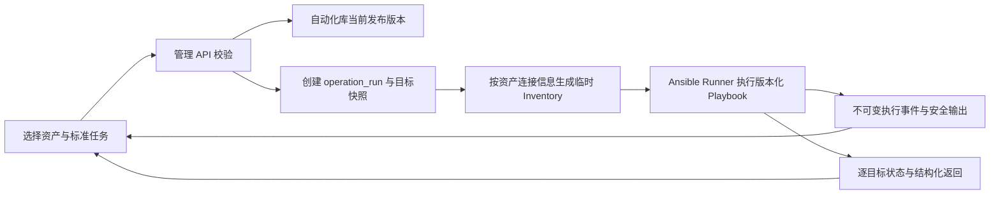

# 标准任务执行流程

AgentsWatch 对服务器、运行时和智能体的操作统一建模为“受控任务”。任务由版本化 Playbook 实现，通过 Ansible Runner 下发；管理 API 不接受 Playbook 路径或任意 Shell。

服务器首次纳管是一个受控的双阶段任务：管理员录入长期 SSH 账号密码并确认扫描到的主机指纹，平台使用密码执行不依赖远端 Python 的 `raw` Bootstrap，安装 Python 3 和平台公钥；随后重新建立一个不含密码的连接执行公钥复验。只有复验成功才将 `bootstrap_status` 置为 `succeeded`，所有普通服务器、运行时和智能体任务都只加载 `credential_ref` 对应私钥。密码密文保存在 reader 无权访问的 `security.server_ssh_credential`，仅在显式首次/重新纳管任务中解密，不作为日常连接失败后的自动回退。

## 用户流程

1. 在资产列表勾选一台或多台目标；未勾选时使用当前选中资产。
2. 点击“执行任务”，页面从 `/api/v1/automation/operations` 重新读取完整已发布任务目录，并展示当前资源类型的全部任务；服务器、运行时和智能体任务互不混排，也不硬编码隐藏单个任务。
3. 选择任务，核对任务说明、版本、风险、超时、sudo 要求和执行目标。
4. 页面根据任务目录的参数定义生成受控表单；中高风险任务必须再次确认。
5. 提交操作编码、目标 UUID 和结构化参数。服务端重新校验任务、参数、目标状态和批量能力。
6. 服务端先冻结本批次的目标清单，再异步执行 Playbook；资产列表后续变化不会改变已创建批次。
7. 接口返回批次 UUID 后页面立即释放，不等待 Playbook 完成；资产页可直接跳转任务中心。
8. 任务中心持续展示排队、预检、Play、Task、Host 和最终收口事件，并分别提供合并输出与逐目标结构化结果。

## 执行链路



## 任务目录契约

每个任务必须声明稳定的 `code`、名称、说明、分类、语义版本、资源范围、Playbook、风险等级、是否需要 sudo、是否支持批量、超时和参数 Schema。`catalog.json` 负责登记内置自动化；数据库自动化库的当前发布版本共同组成唯一可执行白名单。

- `code` 一经使用不得改变语义；不兼容修改应创建新编码。
- `version` 表示任务契约版本，执行记录同时保存 Playbook 内容哈希。
- 参数只支持声明过的字符串、整数、数值、布尔、数组和枚举；未知、缺失或越界参数在下发前拒绝。
- Playbook 使用平台 UUID 作为 Ansible 主机别名，通过 `agentswatch_result` 返回结构化结果。
- 连接凭据只保存引用；执行时由本机环境映射为密钥文件，不写入任务参数、Inventory 资产或结果。
- 运行时配置 `endpoint_port` 后，启动和重启必须等端口可连接，停止必须等端口释放；状态刷新发现服务进程存在但端口不可用时返回 `degraded`。因此任务成功表示操作结果已经可用，而不仅是 systemd/launchd 接受了命令。
- `systemd` 系统服务只有启动、停止和重启要求连接具备 sudo；状态刷新和信息采集不提权。`systemd_user` 始终以 SSH 登录用户执行 `systemctl --user`，显式设置用户运行目录与 D-Bus 地址，严禁 become。

## 数据与状态

- `automation.operation_run`：一次不可变任务批次，保存任务编码、目标类型、参数、发起人、目标数、任务版本及批次状态。
- `automation.operation_host_result`：批次内每个资产目标的状态、结构化结果、错误和起止时间。
- `automation.operation_event`：按批次严格递增的不可变事件流，保存阶段、Play、Task、目标、动作、安全裁剪后的输出和时间。
- `automation.automation_definition`：自动化的稳定身份、适用对象、风险、批量和超时策略。
- `automation.automation_version`：草稿或不可变发布版本，保存 Playbook、参数 Schema、校验报告和内容哈希。
- 批次状态为 `queued / running / succeeded / partial / failed / cancelled`；等待中的任务可安全取消，运行中的任务不会伪装成已中断。
- 禁用或退役资产不能成为新任务目标；未配置连接、凭据无法解析或目标不可达时记录为该目标失败，不吞掉其他目标结果。
- 同一服务器同一时刻只能有一个等待或执行中的任务。服务器、运行时和智能体任务共用该互斥边界，避免并发改写同一运行时。
- 执行器发生未预期异常时，批次和未完成目标自动收口为失败；API 重启会终结已中断的运行中任务，并重新认领尚未开始的等待任务。

## 自动化库与任务中心

“自动化库”和“任务中心”都是与服务器、运行时、智能体同级的一级模块。

- 自动化库：查看内置或自建自动化，新建草稿，编辑 Playbook 与参数 Schema，执行语法校验，发布新版本并查看历史版本。已发布版本禁止覆盖修改。
- 任务中心：跨资源类型查询批次状态、执行人、版本、Ansible 实时过程和逐目标结果；失败或跳过的目标可以创建新的重试批次，并通过 `retry_of_run_id` 保留关系。
- 任务列表接口为 `GET /api/v1/automation/runs`，支持状态、对象类型、自动化编码、发起人与关键词筛选。
- 事件接口为 `GET /api/v1/automation/runs/{run_id}/events`，使用 `after_sequence` 游标分页，支持按 `target_key` 过滤。
- 自动化库接口位于 `/api/v1/automation-library`；发布动作必须以最新一次内容校验通过为前提。

## 新增任务规则

新增服务器任务时必须同时完成：Playbook、目录声明、参数校验用例、本机 Runner 用例和 API 契约用例。页面无需为每个新任务增加固定按钮，目录生效后会自动出现在任务选择器中。

当前服务器任务覆盖首次纳管、连接检查、基础信息采集和运行时发现；运行时任务覆盖实际信息采集、状态刷新和生命周期控制。采集结果按内容哈希去重写入不可变发现快照，未读取 Agent 明细时保留空值，不推测数量。

智能体任务当前覆盖 `agent.apply_deployment`：

- 目标必须是 `testing / active` 的主智能体，以及活动服务器上的裸金属 OpenClaw 运行时。
- 一个运行时最多对应一个活动主智能体；已占用或已有部署任务的运行时会在 Playbook 下发前返回冲突。
- 运行批次冻结主智能体、未退役子智能体、运行时内部 ID 和工作区路径；子智能体随主智能体一起配置，不单独产生部署。
- Playbook 调用 OpenClaw CLI 创建缺失成员、设置显示身份；存在飞书渠道时按 OpenClaw 版本安装官方 `@openclaw/feishu` 插件，为每个主/子智能体创建独立账户并绑定 `feishu:<accountId>` 路由。若该版本要求 capability consent，操作者须先审阅能力声明并在目标运行时显式安装插件；自动化不会无条件接受新增能力。
- AppSecret 通过控制端和远端两个短生命周期 `0600` 文件传递，相关复制与配置命令启用 Ansible `no_log`；任务参数、Inventory、标准输出和结果只记录非敏感账户 ID。
- Runner 每个批次使用独立 `0700` 临时目录；子进程环境采用固定白名单，不继承 API 数据库 DSN、Fernet/Web 凭据密钥等秘密。命令、环境、Inventory 和原始事件在完成后删除，仅保留权限为 `0600` 的脱敏 stdout。API 启动和每次执行前只清理带平台标记且执行锁已释放的陈旧临时目录，不删除现有 `artifacts/`。任务中心事件同时执行 `no_log`、URI 凭据、Token、密码和已知环境密钥脱敏。
- 最终配置校验通过后，Playbook 使用运行时模块相同的 systemd/launchd 控制逻辑重启目标运行时并等待端点恢复，因此同步前页面必须明确提示影响范围。
- 只有 Playbook 返回成功后，服务端才创建或补齐 `AgentDeployment` 与 `AgentDeploymentMember`；执行失败不能只修改数据库冒充部署完成。
- 子智能体退役后，下一次同步解除其飞书路由、删除平台管理的飞书账户并结束当前部署成员有效期，但保留 OpenClaw 智能体和工作区用于审计与恢复。
- 当前只允许首次部署或同步到同一活动运行时。跨运行时迁移需要源端清理与旧部署归档，作为后续独立任务处理。

## 可变数据目录

内置 Playbook、Role 和 `ansible.cfg` 属于代码发布物，始终从代码目录读取。在线发布的 Playbook、保留的安全运行产物和 Runner 私有临时目录属于可变数据，通过 `AGENTSWATCH_AUTOMATION_DATA_ROOT` 统一定位：

```text
/srv/agentswatch/management/automation/
├── managed/    # 在线发布的不可变 Playbook 物化文件
├── artifacts/  # 每个批次仅保留脱敏 stdout
└── .runner/    # 执行期间的 Inventory、环境和原始事件，结束后删除
```

- 生产环境建议设置 `AGENTSWATCH_AUTOMATION_DATA_ROOT=/srv/agentswatch/management/automation`；变量必须是绝对路径。
- 未设置时默认仍使用代码仓库内的 `automation/`，保持现有本机开发和测试行为。
- 数据库存储 `managed/...` 逻辑路径，不绑定 `/opt` 或 `/data`，因此切换数据盘不需要修改历史版本记录。
- 管理 API 和任务执行器必须使用相同环境变量与同一持久化目录；内置 Playbook 不依赖该目录。
