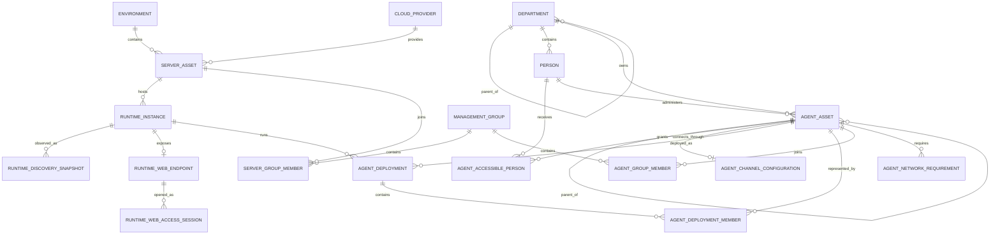

# 核心资产数据架构

> 状态：当前领域模型参考。正式 PostgreSQL 迁移、读写 API、批量导入、管理分组和运维 v2 只读契约均已实现；阶段性验证报告保留为历史证据。系统级边界见[系统架构](system-architecture.md)。

## 1. 文档目的与边界

本文定义管理驾驶舱第二版核心资产模型。模型以 `ServerAsset` 和 `AgentAsset` 为两个核心定义，通过 `RuntimeInstance` 表达服务器上的 OpenClaw、Hermes 等运行时，通过 `ManagementGroup` 表达面向批量管理的虚拟资源分组。

“龙虾”继续作为当前产品称呼，但数据库统一使用框架无关的 Agent；“Gateway”是 Runtime 当前的一种角色，Runtime 与 Agent 保持不同身份，但每个活动 Runtime 最多关联一个主 Agent。

本文只定义核心资产领域及其关系，不重复描述已经实现的 API、页面、自动化和遥测组件。以下内容由其他专项文档负责：

- OpenClaw/Hermes 配置下发与 Secret 处理；
- 数据库、状态目录的生产备份与恢复；
- 时序遥测、告警、执行任务、审批、管理台和看板；
- 登录用户权限；Department/Person 是独立业务组织主数据。

配套文档：

- [核心资产数据字典](core-data-dictionary.md)
- [资产 Excel 导入契约](asset-import-contract.md)
- [核心资产数据模型模拟验证](core-data-model-validation.md)
- [核心资产 PostgreSQL 本机验证报告](core-data-postgresql-validation.md)
- [核心数据接入本机验证报告](core-data-ingest-local-validation.md)
- [核心只读 API 本机验证报告](core-read-api-local-validation.md)

## 2. 已确认的建模决策

1. Server 和 Agent 是两类核心资产，均使用不可变平台 UUID。
2. Agent 不绑定 OpenClaw；框架类型属于 Runtime，支持以后增加 Hermes 等实现。
3. 一台 Server 可以部署多个 Runtime；Runtime 当前角色为 Gateway。
4. 一个 Runtime 同时最多承载一个主 Agent；主 Agent 及其 Subagent 作为一个部署单元运行。
5. 一个主 Agent 当前最多有一个活动 Runtime 部署，但历史上可以迁移多次。
6. 子 Agent 必须隶属于一个主 Agent，并跟随主 Agent 部署到同一 Runtime。
7. Agent 的结构角色和服务类型是两个独立维度。
8. 服务类型唯一且互斥：`personal`、`department`、`business`。
9. 业务管理员和 IT 管理员各最多一人；可访问用户允许多人。它们暂不参与真实鉴权。
10. 平台统一由一个运维团队管理 Server、Runtime 和部署，不为单个 Runtime 建管理员关系。
11. 所谓服务器集群、智能体集群都是虚拟管理分组，不表达 HA、主从或网络拓扑。
12. Server 或主 Agent 可以同时加入多个不同用途的管理分组。
13. Server 配置第一版保存当前值，修改历史由 ChangeLog 记录，不建立复杂规格版本表。

## 3. 核心领域

### 3.1 Environment

运行和管理边界，例如生产、测试、地域和统一平台运维团队。原模型中用于表示 `lobster-prod/prod` 的 Cluster 改为 Environment，避免与虚拟资源分组混淆。

### 3.2 CloudProvider

可维护的云厂商或基础设施来源字典，例如华为云、私有云、其他云。CloudProvider 不使用数据库固定枚举；新增云类型不应要求改表。

### 3.3 ServerAsset

服务器资产。第一版直接保存当前基础配置：云厂商、云实例 ID、CPU 核数、内存 GiB、磁盘总容量 GiB、内外网 IP、操作系统、架构和工作账号。

Server 身份不依赖 IP、云实例 ID 或工作账号。配置修改直接更新当前值、递增 `row_version` 并写入 ChangeLog；未来需要多磁盘、多网卡或多个账号时再拆分子表。

### 3.4 ManagementGroup

用户界面统一称为“管理分组”，数据库使用 `ManagementGroup`，强调其静态批量管理语义。

- `resource_type=server` 时通过 `ServerGroupMember` 关联 Server。
- `resource_type=runtime` 时通过 `RuntimeGroupMember` 关联 Runtime。
- `resource_type=agent` 时通过 `AgentGroupMember` 关联主 Agent。
- 一个资源可以加入多个分组。
- 当前只有静态成员，不支持标签规则动态计算。
- 分组没有主节点、从节点、负载均衡或高可用语义。

### 3.5 RuntimeInstance

服务器上实际部署的智能体运行时。Runtime 的框架和部署方式相互独立：

- `runtime_family`：OpenClaw、Hermes 或后续框架。
- `runtime_role`：第一版固定为 `gateway`。
- `deployment_mode`：`baremetal` 或 `container`。

Runtime 可以暂时不承载 Agent；一个活动 Runtime 最多承载一个主 Agent及其 Subagent。Runtime 跨服务器迁移或裸金属/容器模式切换时创建新 Runtime；普通进程或容器重启不改变 `runtime_id`。

裸金属 Runtime 可选择 `systemd`、`systemd_user`、`launchd` 或 `mock` 管理驱动；`command_path` 仅保存可执行文件绝对路径，不保存命令参数或秘密。初始迁移无法确认管理目标和命令路径时保持 `management_driver=none`、`management_target=null`、`command_path=null`，不得猜测。

### 3.6 RuntimeDiscoverySnapshot

Runtime 的不可变只读发现结果，保存实际版本、配置摘要、插件/扩展摘要、发现到的 Agent 数量及脱敏原始 JSONB。它用于核对计划态和实际状态，不替代正式 AgentAsset。

旧清单只有 `mounted_agents` 数量时，仅写入低可信度观测计数，不凭空生成主 Agent 或子 Agent。

### 3.7 RuntimeWebEndpoint

Runtime 的当前 Web 管理入口。入口身份从属于 Runtime，不因访问会话变化而变化；保存访问通道、地址、页面路径、认证方式和加密凭据。第一版每个 Runtime 只管理一个启用的主入口，支持 SSH 临时隧道、Tailscale Serve 和受控私网地址。

### 3.8 RuntimeWebAccessSession

管理员每次打开 WebUI 形成一条短期访问会话，记录访问通道、状态、到期时间和失败信息。会话不拥有 Runtime 身份，也不保存明文凭据；SSH 隧道到期后由执行进程关闭。

### 3.9 AgentAsset

框架无关的智能体资产。一个 Agent 更换 Runtime、服务器或框架后仍保留相同 `agent_id`。

Agent 有两个正交属性：

| 维度 | 值 | 含义 |
| --- | --- | --- |
| `structure_role` | `primary`, `subagent` | 主智能体或稳定配置的子智能体 |
| `service_archetype` | `personal`, `department`, `business` | 唯一、互斥的服务类型 |

分类规则：

- `personal`：一个主要服务人员的个人数字助手。
- `department`：面向一个主服务部门的综合型助手。
- `business`：解决明确业务领域和场景的专业智能体。

子 Agent 必须关联一个主 Agent，第一阶段只允许一层主从关系。子 Agent 的服务类型必须与主 Agent 相同，不能直接加入 ManagementGroup，也不能独立选择 Runtime。

临时运行中动态生成的 subagent、delegate 或子任务不是 AgentAsset，未来进入执行或遥测领域。

### 3.10 Agent 人员关系

第一阶段只记录人员关系，不据此实现权限：

- `business_admin_person_id`：业务管理员，最多一人。
- `it_admin_person_id`：IT 管理员，最多一人。
- `AgentAccessiblePerson`：主 Agent 的可访问用户，多对多。

进入 `testing` 或 `active` 前，主 Agent 必须填写两名管理员；同一个 Person 可以同时承担两种管理员角色。个人 Agent 还必须关联一个主要服务人员，该人员与可访问用户是不同概念。Subagent 不单独维护可访问用户，跟随主 Agent。

### 3.11 AgentChannelConfiguration

智能体的当前渠道接入配置。没有配置记录或配置已停用表示“不设置渠道”；当前只支持 `feishu`，后续增加渠道类型时不改变 Agent 身份。

- 每个 Primary Agent 和 Subagent 最多一条独立渠道配置；父子渠道之间没有继承或覆盖关系。
- 飞书配置保存应用名、AppID 和加密后的 AppSecret；应用名未填写时使用智能体名称作为默认值。
- AppSecret 只接受写入，不进入详情投影、列表、日志或 ChangeLog；修改 AppID 时必须重新提供 AppSecret。
- 同一启用的飞书 AppID 只能关联一个 Agent，防止误把同一应用配置到多个业务身份。
- 选择“不设置渠道”时停用当前配置，不物理删除历史行。

### 3.12 AgentDeployment

表示一个主 Agent 部署到某个 Runtime 的历史关系。

- 一个主 Agent 可以没有部署。
- 一个主 Agent 同时最多有一个活动部署。
- 一个 Runtime 同时最多有一个活动 AgentDeployment。
- `primary_agent_id` 与固定为 `primary` 的角色判别列组成复合外键，数据库保证 Deployment 不会引用 Subagent，并阻止被引用 Agent 改为 Subagent；外键行锁负责并发序列化。
- 迁移时结束旧部署并创建新部署；Agent 身份不变。

### 3.13 AgentDeploymentMember

表示一次 AgentDeployment 中实际包含的主、子 Agent 及 Runtime 内部标识。

- 每个 Deployment 恰好有一个主成员，必须等于 `AgentDeployment.primary_agent_id`。
- 子成员必须是该主 Agent 的直接子 Agent。
- 成员冗余 `runtime_id`，并通过复合外键保证与所属 Deployment 的 Runtime 一致。
- 同一个 Runtime 内活动的 `runtime_agent_key` 唯一。
- 子 Agent 不拥有独立 Deployment，只作为主 Agent 部署的成员。

### 3.14 Department 与 Person

- Department 使用平台 UUID，部门编码是稳定且不可修改的外部标识，名称和层级允许变化；展示路径当前按层级派生，不持久化。
- Person 使用平台 UUID，人员工号是稳定且不可修改的外部标识，姓名和所属部门允许变化。
- Person 是业务组织档案，登录账号位于独立的 `security.user_account`；两者当前不自动绑定，人员维护不会创建账号或撤销会话。
- 仅有名称而缺少稳定编码时，禁止自动合并对象。

### 3.15 ExternalIdentifier

统一保存平台对象与外部系统编码的映射，例如云实例 ID、旧 Gateway ID、人员工号和部门编码。外部标识在“来源系统 + 标识类型”命名空间内唯一；名称永远不是外部标识。

初始迁移可以用批准工作簿的一次性冻结种子生成 Agent UUID，但该 Runtime 槽位种子不具备长期身份语义。首次事务提交后以平台 `agent_id` 为权威；后续导入只能按平台 UUID 或非冻结种子的当前有效 ExternalIdentifier 匹配，禁止按名称、IP、Runtime 槽位或重新计算种子匹配。`runtime_seed_key` / `agent_seed_key` 只服务于完全相同初始计划的幂等重试。

### 3.16 AgentNetworkRequirement

保存 Agent 需要访问的系统、域名/IP、协议、端口和用途。它是计划态，不代表网络实际可达。子 Agent 默认继承主 Agent 网络需求；只有明确存在差异时才允许子 Agent 建独立需求。

## 4. 关系模型



## 5. 关键基数与约束

### 5.1 Server 与 Runtime

```text
Environment 1 -> N Server
CloudProvider 1 -> N Server
Server 1 -> N Runtime
```

- Runtime 必须部署在一台未退役 Server 上。
- Server 退役前必须结束全部活动 Runtime。
- Server 配置更新不改变 `server_id`。

### 5.2 Runtime 与 Agent

```text
Runtime 1 -> N AgentDeployment
Primary Agent 1 -> N 历史 AgentDeployment
Primary Agent 0 -> 1 活动 AgentDeployment
Primary Agent 1 -> N Subagent
```

- Runtime 可以混合承载不同部门、不同服务类型的主 Agent。
- 主 Agent 的活动部署通过 PostgreSQL 部分唯一索引保证最多一个。
- 子 Agent 必须跟随主 Agent 出现在同一 AgentDeployment 中。
- Agent 更换 Runtime 时不改变 `agent_id`。

### 5.3 Runtime WebUI

- 每个 Runtime 最多有一个启用的主 WebUI 入口。
- SSH 通道只能在 AgentsWatch 本机监听回环地址，并只能转发到服务器回环地址。
- Tailscale Serve 与私网直连保存 HTTP(S) origin；Tailscale Serve 强制 HTTPS。
- 所有凭据加密保存，不进入查询投影和审计内容；每次打开均形成有到期时间的访问会话。

### 5.4 服务类型约束

- Personal：`primary_service_person_id` 必填，主服务部门和业务场景为空。
- Department：`primary_service_department_id` 必填，主要服务人员和业务场景为空。
- Business：`business_domain`、`business_scenario` 必填，主要服务人员和主服务部门为空。
- Subagent：上述字段不单独填写，从主 Agent 继承；`service_archetype` 必须与主 Agent一致。

### 5.4.1 Agent 渠道约束

- Primary Agent 和 Subagent 都可以独立选择“不设置渠道”或配置飞书渠道。
- PostgreSQL 保证一个 Agent 最多一条配置，并保证启用状态下 `(channel_type, app_id)` 唯一。
- 领域服务负责父子渠道相互独立、“不设置渠道”的停用语义、应用名默认值、AppID 变更时重新提供密钥，以及 AppSecret 加密和审计脱敏。

### 5.5 ManagementGroup

- `resource_type=server` 的分组只能出现在 ServerGroupMember。
- `resource_type=agent` 的分组只能包含 `structure_role=primary` 的 Agent。
- Server 或主 Agent 可以属于多个活动分组。
- 移除成员或退役分组不影响资源生命周期。
- 后续批量操作应在任务创建时固化成员快照；本阶段不建任务模型。

### 5.6 身份边界与重建规则

| 对象 | 保留原 UUID | 必须创建新 UUID |
| --- | --- | --- |
| ServerAsset | 改名、IP/容量/OS/工作账号调整、维护和停用 | 云实例或物理机被实际替换，即使复用名称或 IP |
| RuntimeInstance | 进程重启、原地升级、原地配置调整 | 换服务器、裸金属与容器模式切换、Runtime Family 切换、销毁后重建 |
| AgentAsset | 改名、管理员/访问用户/归属调整、Runtime 迁移 | 业务身份被替换；Primary/Subagent 结构角色或 Subagent 父级变化 |
| AgentDeployment | 同一部署从 planned 进入 active | Runtime 变化或旧部署已经结束 |
| ManagementGroup | 改名、用途说明和成员变化 | `resource_type` 变化 |

`service_archetype` 在 `requested` 阶段允许纠正；进入 `testing` 后视为业务身份组成部分，若确需跨 personal/department/business 变更，应退役旧 Agent 并创建新 Agent，避免历史口径混淆。

Runtime 的“重启”和“重建”必须区分：原地重启不改变 runtime_id；销毁并重新部署属于重建，创建新 Runtime。重建时结束旧 Runtime 上唯一的活动 AgentDeployment，并为新 Runtime 创建对应的新 Deployment，agent_id 保持不变。

## 6. 生命周期与状态

| 对象 | 生命周期 |
| --- | --- |
| Environment | `planned`, `active`, `disabled`, `retired` |
| ServerAsset | `planned`, `active`, `maintenance`, `disabled`, `retired` |
| RuntimeInstance | `planned`, `active`, `disabled`, `retired` |
| AgentAsset | `requested`, `testing`, `active`, `suspended`, `retired` |
| AgentDeployment | `planned`, `active`, `inactive`, `retired` |
| ManagementGroup | `active`, `disabled`, `retired` |

Runtime 另有不可人工编辑的观测状态：`unknown`, `running`, `stopped`, `degraded`, `unreachable`。例如生命周期为 `active`、观测状态为 `stopped` 表示异常，观测状态不得覆盖生命周期。

退役是终态。核心资产、部署、分组和成员关系默认 `ON DELETE RESTRICT`，业务操作不提供硬删除。

受控转换如下；表中未列出的转换默认拒绝：

| 对象 | 允许转换 |
| --- | --- |
| ServerAsset | planned→active/retired；active↔maintenance；active/maintenance→disabled/retired；disabled→active/retired |
| RuntimeInstance | planned→active/retired；active→disabled/retired；disabled→active/retired |
| AgentAsset | requested→testing/retired；testing→active/suspended/retired；active↔suspended；active/suspended→retired |
| AgentDeployment | planned→active/retired；active→inactive/retired；inactive→retired |
| ManagementGroup | active↔disabled；active/disabled→retired |

活动 Deployment 只允许指向 `testing/active` 的 Primary Agent 和 `active` Runtime；活动 Runtime 只允许位于 `active/maintenance` Server。Runtime 退役前必须先结束其全部活动 Deployment；主 Agent 退役前必须结束活动 Deployment，并结束活动分组、访问用户等关系。

## 7. 数据来源与历史

| 数据类别 | 典型数据 | 权威来源 |
| --- | --- | --- |
| 计划态 | Server 配置、Agent 分类、管理员、分组、部署计划 | Excel 或未来管理系统 |
| 观测态 | Runtime 实际版本、运行状态、发现 Agent 数和配置摘要 | 只读发现任务 |
| 计算态 | 配置漂移、数据新鲜度、影响范围 | 后续计算服务 |

主表保存当前值并使用 `row_version`。所有确认修改写入不可变 ChangeLog，记录对象、字段、前后值、来源、批次和操作者。

以下关系保存 `valid_from` / `valid_to`：

- AgentDeployment 与 AgentDeploymentMember。
- ServerGroupMember 与 AgentGroupMember。
- AgentAccessiblePerson。
- ExternalIdentifier。

RuntimeDiscoverySnapshot 按内容变化新增，不更新旧快照。原始 JSONB 入库前必须脱敏。

## 8. PostgreSQL 与领域服务边界

### 8.1 PostgreSQL 直接保证

- UUID 主键、非空、枚举、正数和条件 CHECK。
- 外键默认 `ON DELETE RESTRICT`。
- 一个主 Agent 最多一个活动 Deployment：

```sql
CREATE UNIQUE INDEX uq_agent_one_active_deployment
ON asset.agent_deployment (primary_agent_id)
WHERE lifecycle_status = 'active';
```

- `AgentDeploymentMember.runtime_id` 与 Deployment 的复合外键一致性。
- 同一 Runtime 内活动 `runtime_agent_key` 唯一：对成员表建立 `WHERE valid_to IS NULL AND runtime_agent_key IS NOT NULL` 的部分唯一索引。
- 一个 Deployment 最多一个活动 Primary 成员：对成员表建立 `WHERE valid_to IS NULL AND member_role='primary'` 的部分唯一索引。
- 同一 Agent/Person 活动访问关系唯一。
- 同一资源在同一 ManagementGroup 中活动成员关系唯一。
- 外部标识命名空间唯一。
- Department 编码和 Person 工号不可修改，二者禁止物理删除。
- `row_version >= 1`；`valid_to > valid_from`。

### 8.2 导入或领域服务保证

- 生命周期转换和退役前置条件。
- Agent 服务类型的条件必填和互斥字段。
- Subagent 与主 Agent 的服务类型、部署和层级一致。
- ManagementGroup 类型与成员表一致。
- 每个 Deployment 恰好一个主成员。
- Runtime 的裸金属/容器条件字段。
- Agent 在 `testing`/`active` 前管理员是否齐全。
- Department 完整层级不得成环；层级写入使用事务锁串行校验。
- 启用组织关系只能新绑定活动 Department/Person，停用前必须处理在用引用。
- Excel 空值、`__CLEAR__`、对象匹配和乐观并发。
- Runtime 快照脱敏与内容变化判断。

### 8.3 约束责任矩阵

| 规则 | PostgreSQL | 导入/领域服务 | 验证证据 |
| --- | --- | --- | --- |
| UUID、FK、枚举、正数、row_version | PK/FK/CHECK | 错误信息翻译 | 有效/非法 UUID、状态、容量样例 |
| 同云厂商实例编码唯一、同环境活动内网 IP 唯一 | 部分唯一索引 | 退役与复用策略 | 清单重复扫描 |
| 公网 IP 允许 NAT/共享出口复用 | 非唯一部分索引 | 公网 IP 不作为身份或自动匹配键 | 清单重复扫描 |
| Runtime 部署模式条件字段 | CHECK | 镜像和路径语义 | 容器缺镜像反例 |
| 活动 Runtime 的 Server 状态合法 | 无跨行 CHECK | 事务内校验并锁定对象 | 生命周期反例 |
| Agent 服务类型唯一及条件字段 | CHECK 可保证本行互斥 | Subagent 继承、状态转换 | 三种类型正例与继承反例 |
| 两管理员各最多一人 | Agent 表标量 FK | testing/active 前必填 | 缺管理员反例 |
| 可访问用户可多人且当前关系不重复 | 部分唯一索引 | 仅允许 Primary | 多人正例 |
| 一个 Primary 最多一个活动 Deployment | 部分唯一索引 | 迁移事务编排 | 第二活动部署反例 |
| 一个 Runtime 最多一个活动 Primary | `runtime_id` 部分唯一索引 | 下发前锁定并校验占用 | 第二主 Agent 部署反例 |
| Department 编码、Person 工号不可变且主数据不可物理删除 | 标识保护触发器 | API 更新字段白名单；统一改状态 | SQL 触发器与组织 API 集成测试 |
| Department 层级不得成环 | 本行 CHECK 阻止自指 | 递归校验与事务 advisory lock | 三层成环及双会话并发反例 |
| 停用组织对象及新建组织引用合法 | FK 保证对象存在 | `FOR SHARE/FOR UPDATE` 协调状态和引用检查 | 停用冲突与历史停用引用测试 |
| Deployment 与 Member.runtime_id 一致 | 复合 FK | 导入复核 | Runtime 不一致反例 |
| Runtime 内活动 runtime_agent_key 唯一 | Member 部分唯一索引 | 结束 Deployment 时同步结束成员 | key 重复反例 |
| 每个 Deployment 恰好一个主成员 | 部分唯一保证至多一个 | 提交前保证至少一个且身份相同 | 缺失/重复主成员反例 |
| Server/Primary Agent 可加入多组 | 活动关系组合唯一 | 分组类型和 Subagent 禁入 | 多组正例与 Subagent 反例 |
| 退役不物理删除且历史只追加 | RESTRICT、不可变触发器 | 退役前置与 ChangeLog | 本机 RESTRICT/不可变测试通过；跨行编排待领域服务 |
| Excel 空值、清空、并发和整批提交 | 单事务、row lock | 差异引擎和 row_version | 契约已设计；最终需导入原型验证 |

“验证证据”包括内存模拟和本机数据库集成测试。部分唯一索引、复合外键、RESTRICT、不可变触发器和活动部署并发已经在本机 PostgreSQL 16 原型中通过；生产环境仍需重新验证账号权限、参数、锁等待、备份和事务边界。

## 9. 旧清单迁移

旧清单的一行混合 Server、OpenClaw Gateway 和当前产品所称的龙虾。首次迁移暂按“一行一 Server、一 Runtime、一主 Agent”拆分：

| 旧数据 | 新模型 |
| --- | --- |
| `defaults.cluster/env/region/team` | 1 个 Environment |
| `metadata.deploy_location` | 1 个已审核的 CloudProvider + Server.cloud_provider_id |
| `metadata.server_id` | Server 外部标识和 provider_instance_id |
| `host` | Server.internal_ip |
| `gateway_id` | Runtime 旧外部标识 |
| `deployment_mode` | Runtime.deployment_mode |
| `port`、scheme、metrics path | Runtime 端点字段 |
| `openclaw_version` | RuntimeDiscoverySnapshot.actual_version |
| `lobster_name` | 主 Agent.name |
| `department` | Agent.owning_department_id，待部门编码映射 |
| `metadata.status` | Agent.lifecycle_status |
| `it_owner` / `business_owner` | Agent 两个管理员字段，待人员工号映射 |
| `target_user` | Personal 服务人员或可访问用户候选，必须人工确认语义 |
| `service_mode` / `mounted_agents` | Agent 结构和 Runtime 观测计数候选，不能自动生成子 Agent |
| `network_requirements` | AgentNetworkRequirement |
| 飞书应用名、AppID | 可确认归属后写入 AgentChannelConfiguration；名称不用于对象匹配 |
| 飞书 AppSecret、旧交互方式 | AppSecret 只能通过管理界面重新安全录入；旧值不从原始载荷自动提取，交互方式暂保留原始载荷 |

迁移核验要求：

- 每条来源记录的拆分结果必须可追溯，且总数可核对。
- 不生成伪造子 Agent；来源计数只能作为待核对观测值。
- 分组由后续台账明确创建，不能从旧 `cluster` 字段推断。

未匹配人员工号、部门编码、服务类型和子 Agent 明细必须进入迁移问题报告，不能静默补值。

## 10. 场景验收

| 场景 | 预期结果 |
| --- | --- |
| 新 Server 暂无 Runtime | 允许创建 ServerAsset |
| 新主 Agent 尚未部署 | 允许创建 AgentAsset，无活动 Deployment |
| 第二个主 Agent 尝试占用活动 Runtime | 拒绝并报告 `ACTIVE_RUNTIME_DEPLOYMENT_CONFLICT` |
| 主 Agent 迁移 Runtime | 结束旧 Deployment，创建新 Deployment，agent_id 不变 |
| 添加稳定子 Agent | 创建 Subagent 资产并加入主 Agent 当前 Deployment |
| 临时生成 subagent run | 不创建 AgentAsset |
| Server 配置调整 | 更新当前值、递增 row_version、写 ChangeLog |
| Server/Agent 加入多个分组 | 创建多条独立成员关系 |
| 分组退役 | 结束成员关系，不改变资源生命周期 |
| Excel 并发更新 | row_version 不一致时拒绝提交 |
| 旧清单只提供聚合 Agent 数量 | 只保存观测计数，不生成 Agent |

## 11. 非功能假设

- 目标数据库为 PostgreSQL，允许使用 JSONB、事务和部分唯一索引。
- 当前为单组织、单平台运维团队，不做多租户和对象级权限。
- 时间以 `timestamptz` 存储 UTC。
- 设计面向低千级 Server、Runtime 和 Agent，无需分库分表。
- Server 当前配置保持简单；未来拆子表时平台 UUID 和 ChangeLog 保证可迁移。

## 12. 架构与本机原型结论

逻辑数据架构通过本阶段验收，核心实体集合包括：Environment、CloudProvider、ServerAsset、ManagementGroup、RuntimeFamily、RuntimeInstance、RuntimeDiscoverySnapshot、RuntimeWebEndpoint、RuntimeWebAccessSession、AgentAsset、AgentChannelConfiguration、AgentDeployment、AgentDeploymentMember、Department、Person、ExternalIdentifier、AgentNetworkRequirement、ChangeLog、自动化任务及导入暂存对象。

验收证据：

- ER 和身份边界可以明确回答 Server 更换、Agent 迁移、Runtime 重建、Agent 停用和多 Subagent 归属。
- 数据字典覆盖类型、可空性、默认值、枚举、外键、唯一约束、权威来源和敏感级别。
- PostgreSQL 约束与领域服务校验已有责任矩阵，不依赖口头约定。
- Runtime 与主 Agent 一对一、多管理组、裸金属/容器和生命周期场景已通过模拟。
- 旧清单迁移必须先完成只读预览、数量核对和人工问题处理，且不得生成虚假 Subagent。
- 新增、重复、改名、IP 变化、Runtime 迁移、Excel 空值、显式清空、并发修改和退役均有自动化证据。
- `AgentDeploymentMember` 已增加 runtime_id 与复合外键设计，使 Runtime 内 key 唯一约束可以实际落到 PostgreSQL。
- PostgreSQL 16 本机原型已创建 28 张表，并通过数据库约束、历史迁移、不可变记录和双会话并发测试。

Excel 暂存、模拟 Runtime 发现、管理 API、服务器与裸金属 Runtime 操作、Runtime WebUI 打开链路、智能体写操作和飞书渠道密钥安全链路均已在本机验证。后续仍需推进智能体部署/操作、真实运行时发现连接器、权威组织数据消歧和导入确认提交。若实现验证发现必须改变实体身份或基数，应通过新的架构决策记录修改基线，而不是直接改表规避。
