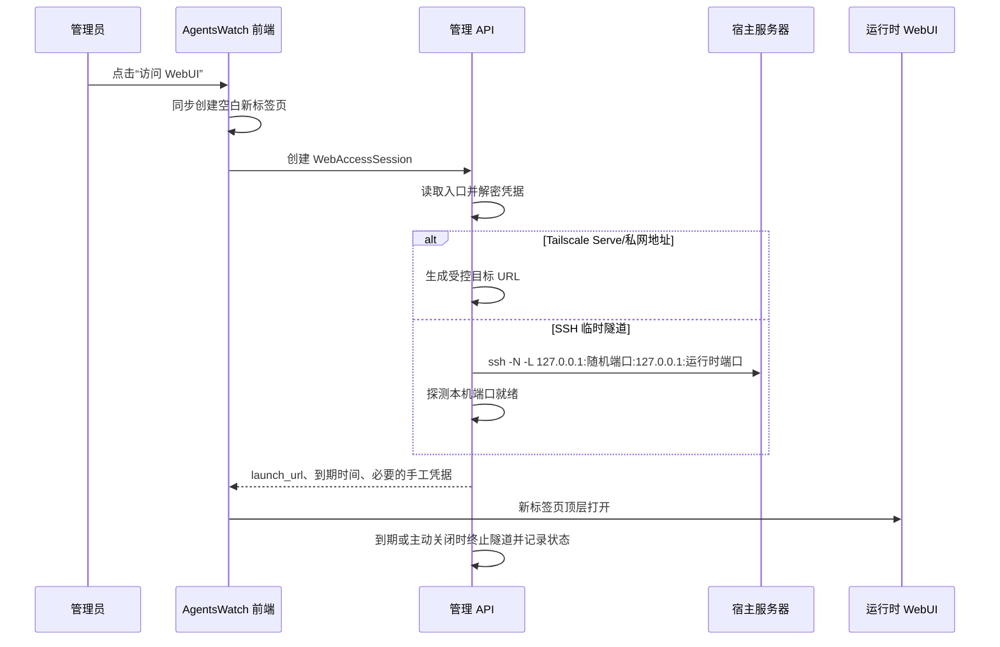

# 运行时 WebUI 访问设计

## 1. 目标

AgentsWatch 为每个运行时保存一个受管理的 WebUI 入口。管理员在运行时详情中点击“访问 WebUI”后，平台建立合适的访问通道并在浏览器新标签页打开目标页面。WebUI 始终保持其原生前端和 WebSocket 行为，不使用 iframe，也不由 AgentsWatch 重写页面。

OpenClaw 的 Control UI 与 Gateway WebSocket 由同一端口提供，默认端口是 `18789`，也支持 `gateway.controlUi.basePath`。认证发生在 WebSocket 握手阶段。官方资料：

- [OpenClaw Web](https://docs.openclaw.ai/web)
- [OpenClaw Control UI](https://docs.openclaw.ai/web/control-ui)
- [OpenClaw Dashboard](https://docs.openclaw.ai/web/dashboard)
- [OpenClaw Tailscale](https://docs.openclaw.ai/gateway/tailscale)

## 2. 访问通道决策

| 通道 | 使用条件 | 安全边界 | 当前支持 |
| --- | --- | --- | --- |
| Tailscale Serve | 服务器与管理员终端均已进入统一 Tailnet | Gateway 保持 loopback；Tailscale 提供 Tailnet 内 HTTPS、ACL 和身份头 | 支持保存 Serve HTTPS 地址并打开；Tailscale 安装与配置 Playbook 后续补充 |
| SSH 临时隧道 | 已配置服务器 SSH，尚未统一 Tailnet | 本机只监听 `127.0.0.1`；远端只转发到 `127.0.0.1/localhost` | 完整支持，当前裸金属默认方案 |
| 私网直接地址 | 已有受控私网、HTTPS 反向代理或其他可信入口 | 由外部网络和代理负责访问控制 | 支持受控 HTTP(S) origin |

不支持 Tailscale Funnel。Control UI 是包含聊天、配置和执行审批的管理面，官方明确不建议公开暴露。

当前最优落地是分阶段的：开发和现有裸金属环境默认使用 SSH 临时隧道；组织完成 Tailnet、节点标签和 ACL 标准化后，将 Tailscale Serve 设为长期首选。两种方案共用同一个 `RuntimeWebEndpoint` 和相同的打开按钮，不改变上层交互。

## 3. 数据模型

`asset.runtime_web_endpoint` 保存当前入口：

- 所属运行时、入口名称和是否启用。
- `local_ssh_tunnel / tailscale_serve / direct_url` 访问模式。
- 协议、地址、远端回环主机、端口覆盖和页面基础路径。
- `none / token / password / username_password` 认证模式。
- 加密后的凭据、最近打开时间和 `row_version`。

`automation.runtime_web_access_session` 保存每次打开记录：请求人、通道、状态、本机端口、隧道进程、创建/激活/到期/关闭时间和失败原因。入口配置修改同时进入不可变 `audit.change_log`，审计内容只包含脱敏字段。

第一版每个运行时只允许一个启用的主入口；数据库使用部分唯一索引保证。运行时类型的 `metadata.web_ui` 声明不同产品的适配能力，OpenClaw 当前声明 `token_delivery=url_fragment`、WebSocket 同端口和只允许顶层窗口。

## 4. 打开流程

浏览器弹窗被拦截时，前端保留已创建的会话并展示一个必须由用户主动点击的打开链接。

## 5. 凭据交付

- 凭据使用 `AGENTSWATCH_WEB_CREDENTIAL_KEY` 加密后保存；本机启动器首次启动时生成 32 字节 Fernet 密钥并以 `0600` 保存。
- 加密正文不会出现在查询 API、差异响应、审计记录或前端详情中。
- OpenClaw Token 通过 `#token=...` URL fragment 一次性交付。fragment 不发送到 HTTP 服务端，OpenClaw 加载后移除它，并只在当前标签页的 `sessionStorage` 中保存。
- OpenClaw 密码不会跨页面刷新持久化。密码或通用账号密码模式在打开后显示一次复制弹窗，由管理员粘贴到目标 WebUI；关闭弹窗即从前端状态移除。
- 修改入口时，秘密输入框留空表示保留原加密凭据；切换为 `none` 会清除已保存凭据。

## 6. Tailscale Serve 配置原则

采用 Tailscale Serve 时应满足：

1. Gateway 使用 `gateway.bind: "loopback"`。
2. `gateway.tailscale.mode: "serve"`，不使用 Funnel。
3. Tailnet 通过节点标签和 ACL 限制可访问的运维人员。
4. 可信宿主机可以使用 `gateway.auth.allowTailscale: true`，由 OpenClaw 校验 Tailscale 身份头；若宿主机上存在不可信本地代码，则设为 `false` 并继续要求 Token/密码。
5. AgentsWatch 保存 Serve 的 `https://<magicdns>/` origin，认证方式按上述信任模型选择 `none` 或共享密钥。

Tailscale 的安装、登录、节点打标、ACL 和 `gateway.tailscale` 配置属于基础设施变更，应在 Playbook 库中形成独立的可审计任务；本增量只实现 WebUI 访问数据与打开链路，不擅自修改服务器网络配置。

## 7. 本机验证边界

本机集成测试首先使用模拟 WebUI，创建裸金属运行时和本机服务器连接，保存加密 Token，创建访问会话，验证 Token fragment、HTTP 页面可达、主动关闭和历史记录。

2026-07-13 又使用开发机上真实运行的 OpenClaw 2026.6.11 完成验证：AgentsWatch 将本机 Gateway `127.0.0.1:16402` 关联到裸金属 Runtime，使用 CLI 生成的 Token 配置入口；Control UI 返回 HTTP 200，AgentsWatch 返回的 URL fragment Token 成功通过 Gateway WebSocket `health` 管理调用认证，访问会话能够关闭并进入历史。数据库中的凭据已验证为 Fernet 密文，明文不在密文或查询 API 中，密钥文件权限为 `0600`。

真实跨主机 SSH 与 Tailscale 网络仍需在具备相应测试节点时做环境验证；当前测试没有连接生产服务器或 Tailnet。
