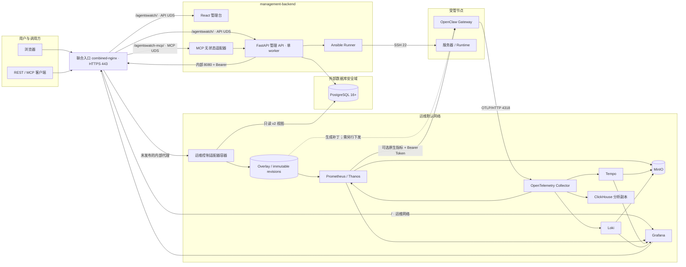
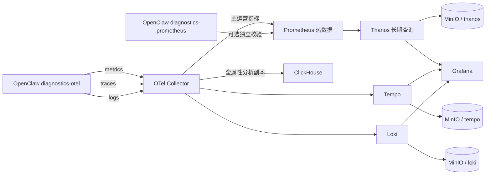
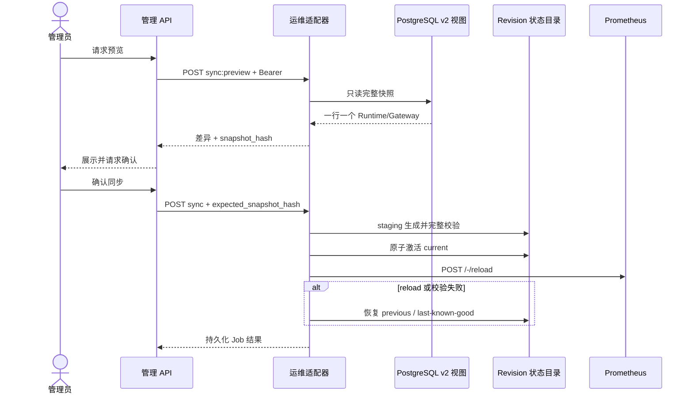

# AgentsWatch 系统架构

本文描述当前实现的系统边界、组件职责、关键数据流和部署约束，是架构评审与部署设计的基线。字段级数据模型见[核心资产数据架构](core-data-architecture.md)和[数据字典](core-data-dictionary.md)，生产操作见[部署指引](deployment-guide.md)。

## 1. 系统目标与边界

AgentsWatch 由两个可以独立交付的模块组成：

- **管理模块**：维护服务器、运行时、智能体、组织、分组和凭据引用，提供批量导入、自动化任务、REST API、MCP 与权限审计。
- **运维模块**：接收 OpenClaw 的 OTel 与原生 Prometheus 数据，完成指标、链路、日志的存储、查询、告警和 Grafana 展示；运维控制适配器负责把资产清单转换为版本化监控配置。

两个模块既可同时部署，也可任一独立部署。联合部署由 `deploy/combined` 统一编排为一个 Compose 项目、一个外部 Nginx 和一个 `443` 入口；管理与运维后端仍分属两个网络，只允许共享 Nginx 跨接。任一模块独立部署时，使用自己的 Nginx 模板和默认端口。

当前系统不是多租户平台，也不是高可用集群：管理 API 的任务执行依赖单进程 worker，运维数据栈是单机 Compose。扩展多 worker 或多副本前，需要先外置任务认领、队列和有状态组件协调机制。

## 2. 总体架构

图中是联合部署拓扑。共享 Nginx 同时挂载管理 UDS、加入管理网络和运维默认网络；管理 API/MCP 不直接加入运维网络，运维适配器也不发布宿主端口。PostgreSQL 位于两套 Compose 网络之外的外部数据库安全域，管理 API 与适配器分别使用不同的最小权限账号和校验服务端身份的 TLS 连接。虚线表示“生成配置”而非自动修改 Gateway，补丁必须通过受控自动化或 `apply_lobster_config.sh` 明确下发。

## 3. 部署单元

### 3.1 管理模块

生产 Compose 位于 `deploy/management/compose.production.example.yml`，包含：

| 组件 | 职责 | 外部暴露 |
| --- | --- | --- |
| `management-nginx` | 仅管理模式的入口，终止 TLS，转发管理台、API 和 MCP | HTTPS，默认 `8443` |
| `management-api` | 领域 API、认证授权、导入、任务调度、Ansible 执行和前端静态资源 | 无 TCP，仅 `api.sock` |
| `management-mcp` | Streamable HTTP 到 REST API 的无状态封装 | 无 TCP，仅 `mcp.sock` |
| 外部 PostgreSQL | 资产事实、组织、导入、任务、安全与审计数据 | 由数据库平台控制 |

API 与 MCP 通过 Compose 私有 `management-run` volume 中的 Unix socket 协作。MCP 不连接数据库、Ansible 或 Shell。仅管理模式由 `management-nginx` 挂载该 volume；联合模式改由 `combined-nginx` 挂载，`management-nginx` 通过 profile 禁用。

管理生产镜像是项目自建多阶段镜像，包含 React 构建产物、FastAPI、MCP、Ansible Runtime 和审核过的内置 Playbook。数据库迁移不在容器启动时隐式执行。

### 3.2 运维模块

根目录 `docker-compose.yml` 是独立的 `lobster-observability` 项目，包含 13 个长期服务和 4 个一次性初始化服务：

- 采集与存储：OpenTelemetry Collector、Prometheus、Alertmanager、Thanos Sidecar/Store/Compact/Query、Tempo、Loki、ClickHouse、MinIO；
- 展示入口：Grafana 与运维专属 Nginx；
- 初始化：`storage-init`、`prometheus-secrets-init`、`nginx-tls-init`、`minio-init`。

运维控制适配器 `agentswatch_observability` 不在根 Compose 中。仅运维模式默认通过 CLI 按需生成 revision；如果要长期开放控制 API，需要另配 supervisor 和安全入口。联合部署覆盖会增加专用适配器容器，并通过共享 Nginx 未发布的内部 `8080` listener 接受管理 API 请求。

### 3.3 联合部署入口与网络

`deploy/combined/compose.production.example.yml` 叠加在根运维 Compose 与管理生产 Compose 之后：

- 把 `nginx` 与 `management-nginx` 放入默认不启用的 `standalone-ingress` profile；
- 新增 `combined-nginx`，成为唯一发布用户 HTTPS 端口的 Web 入口；OTLP 与回环管理端口仍按各自数据面策略发布；
- 新增 `observability-control` 容器，读取管理数据库 v2 视图并写运维 revision；
- 把 `management-api`、`management-mcp` 放入 `management-backend`；
- 让共享 Nginx 同时加入 `management-backend` 与运维默认网络；
- 通过管理 UDS 访问 API/MCP，通过运维网络访问 Grafana 与适配器。

共享入口路由：

| Listener | 路径 | 后端 |
| --- | --- | --- |
| 外部 `HTTPS :443` | `/`、`/api/live/` | Grafana |
| 外部 `HTTPS :443` | `/agentswatch/` | 管理 API UDS（同时提供前端） |
| 外部 `HTTPS :443` | `/agentswatch-mcp/` | MCP UDS |
| 内部 `HTTP :8080`，不发布 | `/api/v1/...` | 运维控制适配器 |

因此联合模式只有一个 TLS 证书、一个外部 HTTPS 端口和一个 Nginx 进程，但后端网络与数据所有权仍然分离。

### 3.4 受管节点

目标服务器不要求安装 Ansible。管理模块通过固定 host key、公钥 SSH 和动态 Inventory 执行审核过的 Playbook；密码只用于显式首次或重新纳管。OpenClaw 通过官方 `diagnostics-otel` 插件推送数据，并可通过官方 `diagnostics-prometheus` 插件提供受 Token 保护的原生指标端点。

## 4. 管理模块逻辑组件

### 4.1 前端

React/Vite 管理台覆盖总览、服务器、运行时、智能体、组织、管理分组、数据导入、自动化库、任务中心、用户权限和可观测接入。生产构建以 `/agentswatch/` 为基础路径，由 API 提供静态文件。

### 4.2 管理 API

浏览器与外部调用方共用 `/api/v1`。API 使用独立的 reader/writer DSN：

- `AGENTSWATCH_DATABASE_URL` 用于读取；
- `AGENTSWATCH_WRITE_DATABASE_URL` 用于写入；
- 写能力还要求 `AGENTSWATCH_ENABLE_MANAGEMENT=true`。

当前 API 固定单 worker。排队任务恢复、执行线程和同服务器互斥都在该进程内完成；不能直接增加 Uvicorn worker 数量。

### 4.3 PostgreSQL 领域

| Schema | 主要内容 |
| --- | --- |
| `asset` | Server、Runtime、Agent、Deployment、管理分组、Web 入口与连接引用 |
| `org` | Department、Person |
| `ingest` | 导入批次、行、问题和字段差异 |
| `automation` | Playbook 版本、任务、事件和逐目标结果 |
| `security` | 用户、会话、API Key、二次确认和加密凭据 |
| `audit` | 不可变变更日志 |
| `integration` | 给运维消费者的版本化只读视图 |

管理数据库是资产身份、组织关系和当前部署绑定的事实来源，不保存遥测时序数据，也不保存 Gateway Prometheus Token。

### 4.4 自动化执行

执行链路是“已发布 Playbook + 参数 Schema → 目标快照 → 动态 Inventory → Ansible Runner → SSH”。调用方不能提交任意 Playbook 路径或 Shell。运行事件、脱敏输出与逐目标结果进入 PostgreSQL；中高风险调用必须完成一次性二次确认。

### 4.5 MCP

MCP 把用户 Bearer API Key 原样用于 REST 访问，并继承 `admin`、`operator`、`viewer` 权限和确认机制。已发布的新 Playbook 通过通用工具发现，不需要让 MCP 获得数据库或执行器权限。

## 5. 运维模块逻辑组件

### 5.1 运维控制适配器

适配器是配置控制面，不是遥测采集器。它从以下来源之一读取完整清单：

- 联合部署：以专用只读账号查询 `integration.observability_gateway_v2`；
- 运维独立部署：读取 `cluster/lobsters.json`。

适配器按 `runtime_id` 对账，将运维 Overlay 与资产快照合并，在 staging 中生成并验证 Prometheus scrape 配置、身份规则、清单快照和 OpenClaw 补丁，随后原子切换 `current` revision。失败时保留或恢复最后一个有效 revision，不会用空清单覆盖生产配置。

采样率、Gateway bind、原生抓取开关以及 scrape host/port 属于运维策略，保存在适配器状态目录的 Overlay；它们不写回管理数据库。

### 5.2 遥测数据面

- OTel metrics 经 Collector 的 Prometheus exporter 进入 Prometheus，是运营看板和告警的主口径。
- 原生 Prometheus 抓取默认关闭；只有 Overlay 显式启用且资产满足 `prometheus_ready` 时才生成目标。它与 OTel 并行用于独立校验，不能把两套指标相加。
- traces 进入 Tempo，logs 进入 Loki；三类 OTel 信号同时写入 ClickHouse 作为分析副本。
- Grafana 默认查询 Thanos、Tempo 和 Loki；当前没有 ClickHouse Grafana 数据源。
- Collector 到 Tempo、Loki、ClickHouse 使用磁盘持久队列和重试；Prometheus exporter 没有持久队列。

### 5.3 遥测身份

OpenClaw 通过官方支持的 OTel headers 传递 `gateway_id`、`runtime_id`、`server_id`、`primary_agent_id` 和 `agent_deployment_id`，Collector 将其转换为 resource attributes。名称、部门、环境等易变展示属性由适配器生成的 `agentswatch_gateway_info` 关联，不作为底层遥测身份。

内容采集保持关闭；Collector 还会删除提示词、响应体、工具输入输出、API Key 和 Authorization 等敏感属性。

## 6. 关键业务流

### 6.1 批量导入

1. 用户上传受支持的 Excel 工作簿。
2. API 解析并暂存行，执行引用、枚举、唯一性和业务约束校验。
3. 系统返回问题和字段级差异，不在预览阶段修改主表。
4. 用户确认后，API 在单个事务中提交合法变更并写入不可变审计。

### 6.2 自动化任务

1. 用户按服务器、运行时、智能体或管理分组选择目标。
2. API 校验 Playbook 状态、参数、权限和风险确认。
3. 任务冻结目标快照，进入队列并按服务器互斥执行。
4. Runner 通过 SSH 执行，持续记录 Play、Task、Host 事件和逐目标结果。
5. 用户从任务中心查看、取消等待任务或重试失败目标。

### 6.3 联合模式清单同步

同步只生成并激活运维配置，不等于把补丁应用到 Gateway；配置下发是后续独立、可审计的动作。

## 7. 数据所有权与持久化

| 数据 | 权威来源 | 默认持久位置 |
| --- | --- | --- |
| 资产、组织、绑定、任务、账号、审计 | 管理 PostgreSQL | 外部 PostgreSQL 16+ |
| 管理自动化产物和加密凭据文件 | 管理模块 | `/srv/agentswatch/management` |
| 运维策略、快照和 revision | 运维适配器 | `/srv/agentswatch/observability-control` |
| Gateway 原生指标 Token | 运维模块独立秘密目录 | `prometheus/secrets/gateways` |
| 指标热数据 | Prometheus | `/srv/agentswatch/prometheus`，默认 15 天 |
| 指标长期数据 | Thanos + MinIO | `thanos` bucket；原始分辨率默认 90 天 |
| Trace | Tempo + MinIO | `tempo` bucket，默认 30 天 |
| Log | Loki + MinIO | `loki` bucket，默认 90 天 |
| OTel 分析副本 | ClickHouse | `/srv/agentswatch/clickhouse`，默认 365 天 |

生产保留周期以部署环境变量为准。容量与数据口径详见[遥测数据持久化](data-persistence.md)。

## 8. 网络与端口

### 8.1 默认对外端口

| 方向 | 端口 | 用途 |
| --- | --- | --- |
| 用户 → 联合部署 | TCP `443` | 统一 HTTPS：Grafana `/`、管理 `/agentswatch/`、MCP `/agentswatch-mcp/mcp` |
| 用户 → 仅管理 | TCP `8443` | 独立管理 HTTPS |
| 用户 → 仅运维 | TCP `443` | 独立运维 HTTPS，仅 Grafana |
| OpenClaw → 运维模块 | TCP `4318` | OTLP/HTTP protobuf |
| 管理模块 → 目标节点 | TCP `22` 或批准的 SSH 端口 | 资产纳管和自动化 |
| Prometheus → OpenClaw | Runtime 实际端口 | 可选原生指标抓取，不应假定全局固定端口 |

### 8.2 默认仅回环发布

Grafana `3000`、Prometheus `9090`、Alertmanager `9093`、Thanos Query `10902`、MinIO Console `9001`、Collector health `13133`、ClickHouse HTTP `8123` 与 native host port `9002` 默认绑定 `127.0.0.1`。联合适配器只在运维容器网络监听 `8011`，不发布到宿主；共享 Nginx 的内部 `8080` 同样不发布。

本机开发端口为前端 `4173`、API `8000`、MCP `8010`、适配器 `8011` 和 PostgreSQL 默认 `55432`，全部只绑定回环地址；它们不是生产拓扑。

## 9. 安全与信任边界

- 联合模式只共享 Nginx 和顶层 Compose 编排；管理/运维后端使用不同网络，管理 UDS 只挂到 API、MCP 和共享 Nginx，数据目录与凭据仍隔离。独立模式不共享入口。
- 管理会话使用 Secure/HttpOnly/SameSite Cookie 与 CSRF；API Key 只存哈希；服务端强制 `admin`、`operator`、`viewer` 权限。
- 密码、SSH 凭据、Runtime WebUI 凭据和渠道 Secret 分别加密或哈希，API 与 MCP 不回显明文。
- 联合模式的数据库账号只允许读取 `integration.observability_gateway_v2`。`default_transaction_read_only` 只是防误操作，真正边界是 PostgreSQL ACL 和对额外权限的拒绝；所有外部数据库连接还必须使用 `sslmode=verify-full` 和受信 CA 校验服务端主机名。
- 适配器控制 API 必须配置非空高强度 Bearer Token。联合模式不把共享 Nginx 的内部 listener 或适配器端口发布到宿主，预期调用方是管理 API；同一容器网络不能替代身份认证，所有控制请求仍由适配器强制校验 Token。代码在 Token 留空时不会自动拒绝请求，因此 Compose 用必填变量强制非空。
- Gateway Token 只存在于独立 Prometheus secret 文件，不进入数据库视图、清单、labels 或 revision。
- 当前 OTLP `4318` 配置没有 TLS 和应用层认证；身份 headers 不是认证。生产必须通过可信网络、ACL 或受控入口限制发送方。
- Loki、Tempo、MinIO 等内部端口依赖“不发布到外网 + Compose 网络”形成边界。
- 联合共享 Nginx 的公网路由只包含 Grafana、管理台和 MCP，适配器仅有未发布的内部 listener；仅管理/仅运维仍各用自己的窄路由模板。

## 10. 故障与降级行为

| 故障 | 预期行为 |
| --- | --- |
| 运维模块未部署 | 管理功能继续工作，可观测接入显示未配置 |
| 管理 API 无法连接适配器 | 只报告失败，不删除运维侧当前 revision |
| 管理数据库不可用 | 运维侧继续使用最后激活 revision 和已有遥测配置 |
| 清单返回空或不完整 | 适配器拒绝用异常快照覆盖当前生产状态 |
| 候选配置校验或 Prometheus reload 失败 | 不激活候选，或恢复前一个 revision |
| Tempo、Loki、ClickHouse 短暂不可用 | Collector 在磁盘队列容量内重试 |
| Prometheus 不可用 | OTel 的其他后端仍可接收；Prometheus exporter 本身没有持久队列 |
| 单管理 API 进程重启 | 恢复 queued 任务并收口异常中断状态；不保证运行中远端命令可无缝续跑 |
| 联合共享 Nginx 不可用 | 管理页面、MCP 与 Grafana 同时失去入口；后端采集、存储和运行中任务继续按各自状态运行 |

## 11. 代码与配置地图

| 路径 | 责任 |
| --- | --- |
| `frontend/` | React 管理台 |
| `agentswatch_api/` | 管理 REST API、认证、领域服务和任务编排 |
| `agentswatch_mcp/` | MCP 到 REST API 的无状态适配 |
| `agentswatch_automation/`、`automation/` | Runner 封装、Playbook 与角色 |
| `database/core-assets/` | PostgreSQL 有序迁移和数据库契约 |
| `agentswatch_observability/` | 运维清单控制适配器 |
| `docker-compose.yml` | 运维遥测数据栈 |
| `deploy/management/` | 管理生产镜像、Compose、Nginx 和直部署样例 |
| `deploy/combined/` | 联合 Compose 覆盖、适配器镜像和共享 Nginx |
| `otel-collector/`、`prometheus/`、`loki/`、`tempo/`、`grafana/` | 运维组件配置 |
| `scripts/` | 迁移、纳管、配置生成、下发、校验和部署辅助工具 |

## 12. 当前已知架构约束

- 管理 API 暂不支持多 worker；运维栈也不是 HA 设计。
- 联合模式已提供适配器容器；仅运维模式若长期开放适配器 API，仍没有独立的生产 supervisor/HTTPS 模板。
- Alertmanager 默认 receiver 不外发通知，生产需按组织渠道补充。
- OTLP 入口当前依赖网络边界；如需跨不可信网络，应先增加 TLS、鉴权或可信代理。
- ClickHouse 是分析副本，不是计费账本，也不是当前 Grafana 主查询源。
- 运维适配器生成 OpenClaw 补丁但不自动下发，避免配置控制面隐式获得 SSH 写权限。
